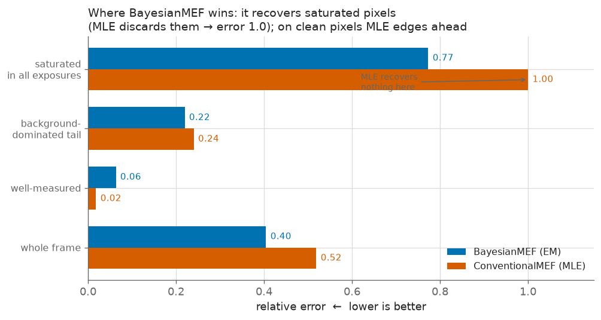
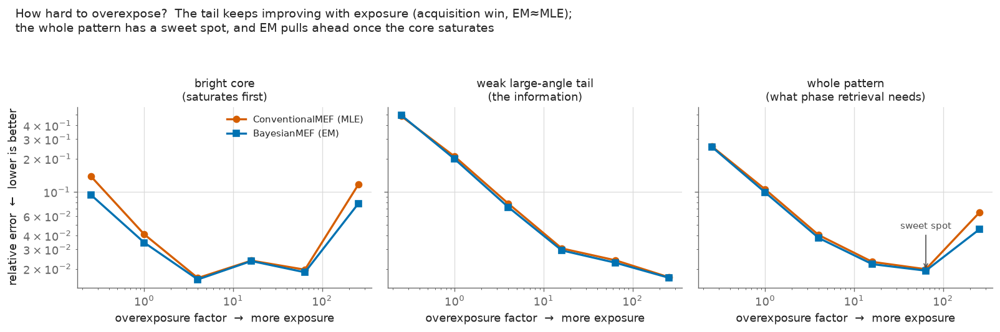
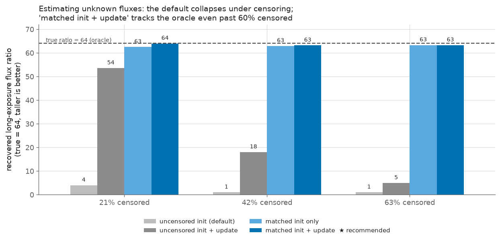

# When does Bayesian MEF help, and how should you acquire the data?

A study of `BayesianMEF` (EM) versus `ConventionalMEF` (MLE), the effect of
overexposure, and how to estimate flux factors under heavy censoring.
Reproduce with [`mef_regime_study.py`](mef_regime_study.py):

```bash
uv run python benchmarks/mef_regime_study.py all        # or: regimes | overexpose | flux
uv run python benchmarks/plot_findings.py               # regenerate the figures below
```

The figures live in [`figures/`](figures/). Every axis states which direction is
"good", so the recommendation is readable at a glance.

**Setup.** The target is a diffraction pattern `|FFT(object)|²` on the paper's
HDR exposure ladder: a bright core that saturates the long exposures and a weak
large-angle tail near the noise floor. Unless the experiment is explicitly about
flux estimation, *both* methods are given the true threshold, exposure times and
background, so we compare the fusion algorithm alone. Quality is a scale-invariant
relative L2 on amplitude (`√intensity`, what phase retrieval consumes); a plain
whole-image correlation saturates near 1.0 and hides every effect below.

Numbers below are 4-seed means at 128×128; exact values move slightly with seed
count and image size, but the ordering and the conclusions are stable.

---

## 1. The single mechanism: EM recovers censored pixels



`ConventionalMEF` does one-shot MLE — it *discards saturated pixels entirely* and
hard-subtracts the background. `BayesianMEF` iterates: it *recovers* saturated
pixels via the censored-Poisson expectation and treats the background softly.

Splitting the error by pixel type for one low-SNR HDR frame (peak=6, bg=60,
~60 % censored) shows exactly where the difference lives:

| pixel regime | EM rel-err | MLE rel-err |
| --- | ---: | ---: |
| saturated in *every* exposure | **0.77** | 1.00 *(no information recovered)* |
| background-dominated tail | **0.22** | 0.24 |
| well-measured | 0.063 | **0.018** |
| whole frame | **0.40** | 0.52 |

- On **saturated** pixels MLE recovers nothing (rel-err 1.0); EM recovers them.
- On **well-measured** pixels MLE is *better* — an unbiased ML estimate beats
  EM's mildly prior-biased one.
- EM wins the frame **only because** a large fraction of pixels are saturated.

**Low SNR by itself does not favour EM.** With censoring disabled (threshold set
huge), MLE is marginally better and its lead grows as SNR drops. What looks like
a low-SNR effect is really censoring: a weak/low-SNR sample is exactly when you
push exposure into saturation, and *that* is what EM handles. Background is only
a secondary amplifier.

**Saturation sweep** (whole-frame rel-err, bg=20):

| saturation | EM | MLE | MLE/EM |
| ---: | ---: | ---: | ---: |
| 42 % | 0.052 | 0.065 | 1.26× |
| 56 % | 0.325 | 0.417 | 1.28× |
| 67 % | 0.575 | 0.727 | 1.27× |
| 90 % | 0.762 | 0.980 | 1.29× (both poor) |

### What is useful when

| situation | use | why |
| --- | --- | --- |
| little/no saturation, any SNR | **ConventionalMEF** | equivalent quality, one-shot, ~200× cheaper |
| moderate–heavy censoring | **BayesianMEF** | only it recovers saturated pixels |
| weak scatterer pushed into saturation for HDR | **BayesianMEF** | the paper's regime |
| best accuracy on clean midtones | ConventionalMEF | unbiased ML beats EM's prior there |

---

## 2. How hard should you overexpose?



Ladder `OE · [1, 8, 64]`, bg=30. Error is tracked separately on the bright core
(brightest 8 %), the weak large-angle tail (dimmest 55 %, where the information
is), and the whole pattern (EM / MLE rel-err):

| OE | censored | core EM/MLE | tail EM/MLE | whole EM/MLE |
| ---: | ---: | --- | --- | --- |
| 0.25 | 0 % | 0.094 / 0.139 | 0.495 / 0.485 | 0.256 / 0.258 |
| 1 | 0 % | 0.035 / 0.041 | 0.198 / 0.208 | 0.099 / 0.105 |
| 4 | 0 % | 0.016 / 0.017 | 0.073 / 0.078 | 0.038 / 0.040 |
| 16 | 33 % | 0.024 / 0.024 | 0.029 / 0.031 | 0.022 / 0.023 |
| **64** | 41 % | 0.019 / 0.020 | 0.023 / 0.024 | **0.019 / 0.020** ← sweet spot |
| 256 | 67 % | **0.078 / 0.116** | 0.017 / 0.017 | 0.046 / 0.065 |

Three separable effects:

1. **The weak tail improves monotonically with exposure** (0.50 → 0.017). This is
   an *acquisition* effect, not a fusion-method effect (EM ≈ MLE on the tail).
   Overexposing to lift the large-angle scattering above the noise floor is the
   single biggest quality lever.
2. **The whole pattern has a sweet spot** (~30–50 % censored here). Past it, the
   tail barely improves but the saturated core degrades and whole-frame error
   climbs again.
3. **EM's payoff appears exactly at heavy overexposure.** EM does not recover the
   tail better — it protects the **core**, so you can overexpose *harder* before
   the pattern breaks. MLE's black-holed core shortens the usable range.

**Background is a hard floor.** Once it approaches the saturation threshold the
long frame saturates on background alone and no exposure strategy helps; EM keeps
a ~15–25 % edge but cannot rescue it. Check that detector background stays well
below the threshold before committing to a heavy ladder.

---

## 3. Estimating flux factors under heavy censoring



When exposure times are not known, they are estimated from the data. The
`"uncensored"` initialiser sums each exposure over its *own* uncensored pixels,
which undercounts long exposures (their brightest pixels are the censored ones).
`"matched"` uses only pixels uncensored in *every* exposure and subtracts the
background. Either can then be refined with `update_fluxes=True`. This study is
why the library now defaults to `flux_init="matched"` with refinement enabled.

True ratios **1 : 8 : 64**, bg=30 (recovered ratios, and fused rel-err):

| censoring | strategy | rel-err | ratios |
| ---: | --- | ---: | --- |
| 21 % | oracle (true times) | 0.019 | 1 : 8.00 : 64.00 |
| 21 % | uncensored init *(old default)* | 0.304 | 1 : 5.26 : **3.96** ← collapses |
| 21 % | uncensored init + update | 0.029 | 1 : 7.80 : 53.56 |
| 21 % | matched init only | 0.019 | 1 : 7.82 : 62.50 |
| 21 % | **matched init + update** | **0.019** | **1 : 8.00 : 64.00** ← = oracle |

Across censoring levels (library, matched init):

| censoring | matched init only | matched + update | oracle rel-err |
| ---: | --- | --- | ---: |
| 21 % | 1 : 7.82 : 62.5 | **1 : 8.00 : 64.0** | 0.019 |
| 42 % | 1 : 7.89 : 63.1 | 1 : 7.98 : 63.3 | 0.047 |
| 63 % | 1 : 7.88 : 63.0 | 1 : 7.93 : 63.0 | 0.256 |

Findings:

- **The initialiser does the heavy lifting.** `matched` init *alone* is near-oracle
  and stable at every censoring level. `update_fluxes=True` adds a small polish
  (exact oracle at 21 %) and, importantly, does **not** destabilise even at 63 %.
- **The old default was the trap.** `flux_init="uncensored"` collapses under heavy
  overexposure (long-exposure flux falls *below* the mid exposure), which is why
  `"matched"` is now the default. Sharper rule than "for strongly-scattering
  data": **use `matched` whenever censoring is non-trivial.**
- A prototyped alternative in-loop update (refine each flux from its own
  uncensored pixels only) did **not** beat `matched + update` — the existing
  update already reaches the oracle, so there is no headroom. No algorithmic
  change was needed; the optimal strategy already existed and is now the default.

### Recommended recipe

```python
from bayes_mef import BayesianMEF

mef = BayesianMEF(
    data,
    threshold,
    background=bg,
    flux_init="matched",  # init from common non-saturated pixels + bg subtraction
    update_fluxes=True,  # EM polish; stable even past 60% censoring
)
mef.run(n_iter=200)
```

If exposure times can be calibrated independently (shutter/beam monitor), pass
`times=` explicitly — still strictly best, but `matched + update` lands within
noise of it.

---

## Bottom line

- Overexpose to bring the large-angle scattering above the noise floor — the
  biggest single lever, and independent of the fusion algorithm.
- Target moderate–heavy censoring (~30–50 %), not the extreme; there is a sweet
  spot for whole-pattern quality.
- Use **BayesianMEF** *because* you overexpose: it keeps the saturated core usable
  and extends how far you can push. On lightly-exposed data it merely ties
  ConventionalMEF, so there is no downside to adopting it now and scaling up.
- Watch the background — near the saturation threshold, no method or exposure
  strategy recovers the signal.
- When fluxes are unknown, use `flux_init="matched"` + `update_fluxes=True`;
  calibrate exposure times independently where possible.

---

## Performance

Fusing 256 scan positions of 6 exposures at 256×256, 150 EM iterations, on a
64-core host with an NVIDIA H200 (`bench_mef.py`, single precision). Vectorising
the whole scan stack into one compiled program is the win — plain JAX on CPU
already beats 32 joblib worker processes, so there is no separate parallel
implementation to choose between:

| backend                               | time    | speedup |
| ------------------------------------- | ------- | ------- |
| NumPy + joblib, 32 processes (v0.1.9) | 41.1 s  | 1.0×    |
| JAX, CPU                              | 17.4 s  | 2.4×    |
| JAX, H200 GPU                         |  3.5 s  | 11.8×   |
